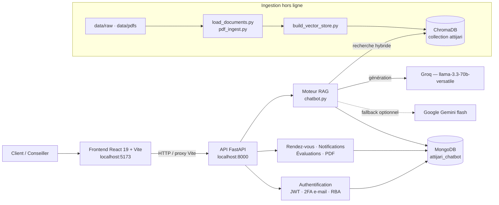

# Conseiller Client Augmenté par Intelligence Artificielle

> Projet de Fin d'Études — Assistant conversationnel RAG pour Attijari Bank Tunisie

Application web complète qui augmente le conseiller client bancaire : un chatbot RAG
répond aux questions sur les produits de la banque (crédits, cartes, offres) en
**français** et en **dialecte tunisien (derja)**, en s'appuyant exclusivement sur la
documentation interne vectorisée — pas sur les connaissances générales du modèle.

Le projet couvre la chaîne complète : ingestion documentaire, recherche hybride,
génération de réponses, authentification forte (2FA + scoring de risque), prise de
rendez-vous, et évaluation automatisée de la qualité du RAG.

---

## Sommaire

- [Fonctionnalités](#fonctionnalités)
- [Architecture](#architecture)
- [Stack technique](#stack-technique)
- [Prérequis](#prérequis)
- [Installation](#installation)
- [Variables d'environnement](#variables-denvironnement)
- [Lancement](#lancement)
- [Structure du projet](#structure-du-projet)
- [API](#api)
- [Évaluation et tests de charge](#évaluation-et-tests-de-charge)
- [Limites connues](#limites-connues)

---

## Fonctionnalités

### Assistant conversationnel

- **RAG bilingue** — détection automatique de la langue (français / derja) avec des
  prompts et des températures distincts (`0.1` en français pour la précision factuelle,
  `0.3` en derja pour le naturel de la langue).
- **Recherche hybride** — combinaison de la similarité vectorielle dense et d'un
  filtrage par catégorie de produit détectée dans la question.
- **Réécriture de requête** — la question est reformulée et classée par catégorie avant
  la recherche, pour améliorer le rappel.
- **Upload de PDF** — un utilisateur peut téléverser un document et interroger son
  contenu dans une collection vectorielle isolée.
- **Documents partagés** — l'administrateur diffuse des PDF aux conseillers, avec suivi
  des lectures.

### Sécurité et authentification

- **JWT** pour l'authentification des sessions.
- **2FA par e-mail** — code à usage unique envoyé par SMTP Gmail, avec expiration et
  limitation du nombre de tentatives.
- **RBA (Risk-Based Authentication)** — scoring de risque à la connexion inspiré de
  l'article 18 de la DSP2 (analyse du risque de transaction). Sept facteurs pondérés
  (nouvel appareil, nouvelle ville, nouveau pays, horaire inhabituel, saut
  géographique, appareil partagé, user-agent suspect) produisent un score de 0 à 100 et
  une décision : `ALLOW`, `WARN`, `ALERT` ou `BLOCK`.
- **Appareils de confiance** — un appareil validé est mémorisé 30 jours et dispense de 2FA.
- **Chiffrement Fernet** des données client sensibles au repos (téléphone, date de
  naissance, revenus mensuels).
- **Journal d'audit** des actions de sécurité et signalement « ce n'était pas moi ».

### Métier

- **Prise de rendez-vous** — demande côté client, validation / refus / proposition de
  créneaux alternatifs côté conseiller, calendrier de disponibilités.
- **Notifications** in-app.
- **Synthèse client générée par IA** à partir du dossier d'un client.

### Qualité et supervision

- **Juge LLM** (`api/llm_judge.py`) — notation automatique des réponses du chatbot.
- **Tableau de bord administrateur** — statistiques d'usage, sessions actives,
  évaluations quotidiennes, détection des conversations problématiques.

---

## Architecture



**Flux d'une question.** Le frontend envoie la question à `POST /chat`. L'API valide le
JWT, puis `chatbot.py` détecte la langue, réécrit la requête et en déduit la catégorie
de produit, interroge ChromaDB en recherche hybride, assemble le contexte et appelle
Groq pour générer la réponse. La conversation est persistée dans MongoDB, puis évaluée
en arrière-plan par le juge LLM.

---

## Stack technique

| Couche | Technologie |
|---|---|
| Frontend | React 19, Vite 7, Recharts, Lucide React |
| Backend | FastAPI 0.104, Uvicorn, Pydantic |
| Orchestration LLM | LangChain (`langchain-core`, `langchain-chroma`, `langchain-huggingface`) |
| LLM principal | Groq — `llama-3.3-70b-versatile` (endpoint compatible OpenAI) |
| LLM de secours | Google Gemini — `gemini-flash-latest` |
| Embeddings | Modèle fine-tuné `models/attijari-model-v2` (dérivé de BAAI/bge-m3) |
| Base vectorielle | ChromaDB (persistance locale dans `chroma_db/`) |
| Base de données | MongoDB — base `attijari_chatbot` |
| Sécurité | python-jose (JWT), passlib/bcrypt, cryptography (Fernet) |
| Tests de charge | Locust |

---

## Prérequis

| Outil | Version | Rôle |
|---|---|---|
| Python | 3.11+ | Backend et pipeline RAG |
| Node.js | 18+ | Frontend React |
| MongoDB | 5.0+ | Base de données (locale ou Atlas) |
| Clé API Groq | — | Génération des réponses ([console.groq.com](https://console.groq.com)) |
| Clé API Gemini | optionnelle | Modèle de secours ([aistudio.google.com](https://aistudio.google.com)) |
| Compte Gmail | — | Envoi des codes 2FA (mot de passe d'application) |

---

## Installation

### 1. Cloner le dépôt

```bash
git clone https://github.com/sofienkrir/Conseiller-Client-le-Augment-par-Intelligence-Artificielle_PFE.git
cd Conseiller-Client-le-Augment-par-Intelligence-Artificielle_PFE
```

### 2. Backend — environnement virtuel et dépendances

```bash
python -m venv venv

# Windows
venv\Scripts\activate
# macOS / Linux
source venv/bin/activate

pip install -r requirements.txt
```

### 3. Frontend

```bash
cd attijari_chatbot
npm install
cd ..
```

### 4. Configurer les variables d'environnement

Copier le modèle fourni, puis renseigner les valeurs réelles :

```bash
# Windows
copy .env.example .env
# macOS / Linux
cp .env.example .env
```

Générer les deux secrets cryptographiques requis :

```bash
# Clé de chiffrement Fernet (ENCRYPTION_KEY)
python -c "from cryptography.fernet import Fernet; print(Fernet.generate_key().decode())"

# Secret de signature JWT (JWT_SECRET_KEY)
python -c "import secrets; print(secrets.token_urlsafe(48))"
```

Le détail de chaque variable figure dans la [section suivante](#variables-denvironnement).

### 5. Construire la base vectorielle

> **Note** — le modèle d'embeddings fine-tuné (`models/attijari-model-v2`, ~450 Mo)
> n'est pas versionné dans ce dépôt. Pour reproduire l'indexation, placez-le dans
> `models/`, ou remplacez `EMBEDDING_MODEL_PATH` dans `build_vector_store.py` et
> `chatbot.py` par le modèle public `"BAAI/bge-m3"`, qui sera téléchargé
> automatiquement depuis Hugging Face.

```bash
python build_vector_store.py
```

Cette étape lit `data/processed/*.json` et `data/pdfs/`, découpe les documents en
chunks, calcule les embeddings et persiste la collection `attijari` dans `chroma_db/`.

### 6. Créer les comptes de démonstration

```bash
python scripts/seed_demo_users.py   # comptes de démo
python make_admin.py                # promouvoir un compte en administrateur
```

---

## Variables d'environnement

Toutes les variables se déclarent dans le fichier `.env` à la racine. Ce fichier est
exclu du versionnement — **ne jamais le commiter**.

### Requis

| Variable | Description |
|---|---|
| `GROQ_API_KEY` | Clé API Groq — génération des réponses du chatbot |
| `JWT_SECRET_KEY` | Secret de signature des jetons d'authentification |
| `ENCRYPTION_KEY` | Clé Fernet de chiffrement des données client sensibles |
| `MONGO_URI` | Chaîne de connexion MongoDB — défaut `mongodb://localhost:27017` |

### 2FA par e-mail

| Variable | Défaut | Description |
|---|---|---|
| `GMAIL_USER` | — | Compte Gmail expéditeur des codes |
| `GMAIL_APP_PASSWORD` | — | Mot de passe d'application Google (pas le mot de passe du compte) |
| `TWO_FA_ENABLED` | `true` | Active la double authentification |
| `TWO_FA_CODE_EXPIRY_MINUTES` | `10` | Durée de validité du code |
| `TWO_FA_MAX_ATTEMPTS` | `5` | Tentatives avant blocage |
| `TRUSTED_DEVICE_DAYS` | `30` | Durée de mémorisation d'un appareil de confiance |

### Optionnel

| Variable | Défaut | Description |
|---|---|---|
| `GEMINI_API_KEY` | — | Clé API Google Gemini (modèle de secours) |
| `USE_GEMINI` | `true` | Active le recours à Gemini |
| `FRONTEND_URL` | `http://localhost:5173` | URL utilisée dans les liens des e-mails |

### Pondérations du scoring de risque (RBA)

Chaque facteur contribue au score de risque de connexion. Les valeurs par défaut
conviennent à une démonstration ; les ajuster permet de durcir ou d'assouplir la
politique de sécurité.

| Variable | Défaut | Facteur déclencheur |
|---|---|---|
| `RISK_GEO_JUMP` | `50` | Déplacement géographique impossible entre deux connexions |
| `RISK_NEW_COUNTRY` | `35` | Connexion depuis un nouveau pays |
| `RISK_SUSPICIOUS_UA` | `35` | User-agent suspect (outil automatisé) |
| `RISK_NEW_DEVICE` | `25` | Appareil inconnu |
| `RISK_SHARED_DEVICE` | `25` | Appareil déjà utilisé par un autre compte |
| `RISK_NEW_CITY` | `15` | Nouvelle ville |
| `RISK_UNUSUAL_HOUR` | `10` | Connexion à une heure inhabituelle pour l'utilisateur |

---

## Lancement

Deux terminaux, l'environnement virtuel activé dans le premier.

**Terminal 1 — API FastAPI**

```bash
uvicorn api.app:app --reload --port 8000
```

- API : http://127.0.0.1:8000
- Documentation interactive (Swagger) : http://127.0.0.1:8000/docs

**Terminal 2 — Frontend React**

```bash
cd attijari_chatbot
npm run dev
```

- Application : http://localhost:5173

Le serveur de développement Vite proxifie `/chat`, `/auth`, `/admin`, `/api`,
`/history`, `/upload_pdf`, `/shared_pdfs` et `/transcribe` vers le backend sur le port
8000 — aucune configuration CORS supplémentaire n'est nécessaire en développement.

---

## Structure du projet

```
.
├── api/                          # Backend FastAPI
│   ├── app.py                    # Point d'entrée, CORS, enregistrement des routeurs
│   ├── routes.py                 # Chat, historique, endpoints d'administration
│   ├── auth_routes.py            # Inscription, connexion, 2FA
│   ├── auth_db.py                # Utilisateurs, hachage, émission des JWT
│   ├── two_factor.py             # Codes à usage unique par e-mail
│   ├── risk_scoring.py           # Scoring de risque RBA (DSP2)
│   ├── device_tracking.py        # Empreinte et suivi des appareils
│   ├── trusted_devices.py        # Appareils de confiance
│   ├── crypto_utils.py           # Chiffrement Fernet des données sensibles
│   ├── appointment_routes.py     # Rendez-vous
│   ├── evaluation_routes.py      # Évaluation des réponses
│   ├── llm_judge.py              # Notation automatique par LLM
│   ├── pdf_upload.py             # Upload et interrogation de PDF
│   └── gemini_model.py           # Client Gemini (fallback)
│
├── attijari_chatbot/             # Frontend React + Vite
│   ├── src/
│   │   ├── App.jsx               # Interface de chat
│   │   ├── AuthPages.jsx         # Connexion, inscription, 2FA
│   │   ├── Admindashboard.jsx    # Tableau de bord administrateur
│   │   └── pages/                # Sessions, évaluations, rendez-vous
│   └── vite.config.js            # Proxy de développement vers le backend
│
├── chatbot.py                    # Moteur RAG : recherche hybride, prompts, génération
├── build_vector_store.py         # Construction de l'index ChromaDB
├── load_documents.py             # Chargement et découpage du corpus JSON
├── pdf_ingest.py                 # Extraction de texte des PDF
├── scraper/                      # Collecte des données produits
├── data/                         # Corpus : raw, processed, pdfs
├── scripts/                      # Utilitaires (seed, migrations, maintenance)
│
├── rag_metrics.py                # Métriques de qualité du RAG
├── rag_build_gold.py             # Construction du jeu de référence
├── rag_preannotate.py            # Pré-annotation assistée par LLM
├── run_evaluation.py             # Exécution du protocole d'évaluation
├── locustfile.py                 # Scénarios de test de charge
├── get_test_token.py             # Génération d'un JWT pour Locust
├── monitor_resources.py          # Mesure CPU / mémoire sous charge
│
├── requirements.txt
├── .env.example
├── PROJECT_SUMMARY.md            # Documentation d'architecture détaillée
└── RAPPORT_TECHNIQUE.md          # Rapport technique du PFE
```

---

## API

Documentation interactive complète sur http://127.0.0.1:8000/docs une fois l'API lancée.

### Principaux endpoints

| Méthode | Route | Rôle |
|---|---|---|
| `POST` | `/chat` | Poser une question au chatbot |
| `POST` | `/auth/register` · `/auth/login` | Création de compte, connexion |
| `POST` | `/auth/verify-2fa` · `/auth/resend-2fa` | Validation du code 2FA |
| `GET` | `/history/list` · `/history/{conv_id}` | Historique des conversations |
| `POST` | `/upload_pdf` | Téléverser un PDF et l'interroger |
| `POST` | `/appointments/request` | Demander un rendez-vous |
| `GET` | `/admin/stats` | Statistiques d'usage |
| `GET` | `/admin/evaluations/stats` | Qualité des réponses |
| `GET` | `/admin/clients` | Dossiers clients |
| `GET` | `/health` | Sonde de santé |

---

## Évaluation et tests de charge

### Qualité du RAG

Le protocole repose sur un jeu de référence annoté (`rag_gold_*.json`) construit en deux
temps : pré-annotation assistée par LLM, puis validation manuelle.

```bash
python rag_build_gold.py     # construire le jeu de référence
python rag_preannotate.py    # pré-annoter avec un LLM
python rag_metrics.py        # calculer les métriques
python run_evaluation.py     # exécuter le protocole complet
```

Les résultats sont exportés en LaTeX (`rag_metrics_success_only_table.tex`) pour
intégration directe dans le rapport.

### Tests de charge

```bash
# 1. Générer un JWT valide (contourne la 2FA sans la désactiver)
python get_test_token.py

# 2. Le placer dans l'environnement
export CHAT_JWT="<token>"        # macOS / Linux
$env:CHAT_JWT = "<token>"        # Windows PowerShell

# 3. Lancer Locust
locust -f locustfile.py --host http://127.0.0.1:8000
```

Interface Locust sur http://localhost:8089. `monitor_resources.py` enregistre en
parallèle la consommation CPU et mémoire du serveur.

---

## Limites connues

Points identifiés et documentés — choix assumés de prototype, et non des oublis :

- **Streaming simulé** — la réponse est générée intégralement avant d'être restituée mot
  à mot côté client. L'effet visuel est celui d'un streaming, mais la latence perçue
  correspond à la génération complète.
- **Contrôle de rôle à renforcer** — les endpoints `/admin/*` vérifient
  l'authentification ; le contrôle du rôle administrateur doit être systématisé côté
  serveur avant tout usage réel.
- **Chargement de la collection** — `hybrid_search()` recharge l'ensemble des documents
  à chaque requête. Acceptable au volume actuel, à optimiser avant une mise à l'échelle.
- **Modèle d'embeddings non versionné** — le modèle fine-tuné (~450 Mo) est exclu du
  dépôt ; voir l'[étape 5 de l'installation](#5-construire-la-base-vectorielle).

---

## Auteur

**Sofien Krir** — Projet de Fin d'Études, Attijari Bank Tunisie.

Ce dépôt est publié à des fins académiques et de démonstration. Les données clients
présentes dans le corpus de test sont entièrement fictives et générées
(`generate_fake_clients.py`).
