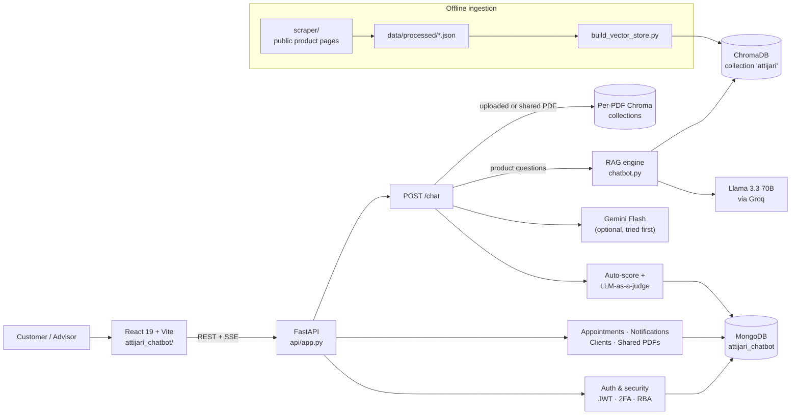
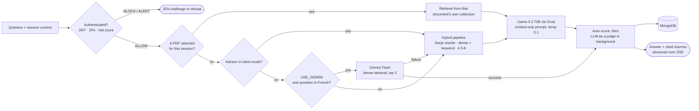
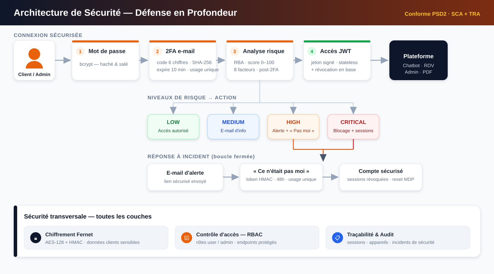
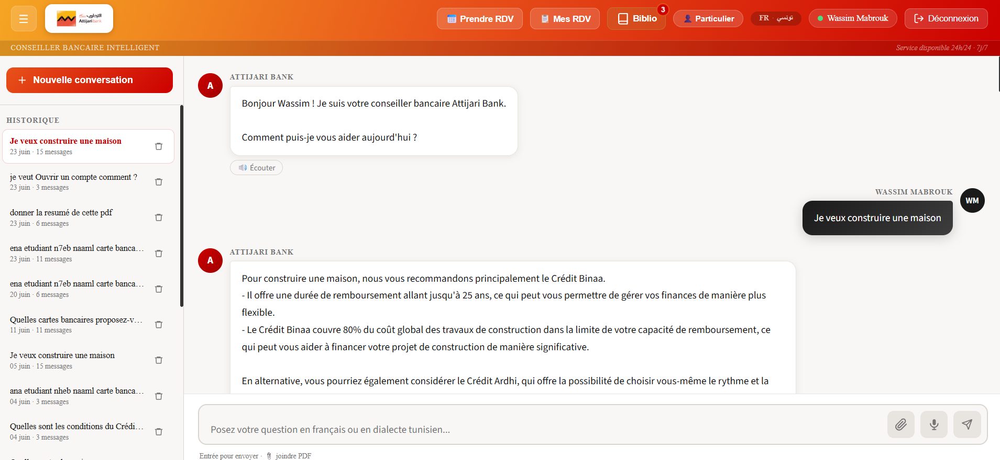
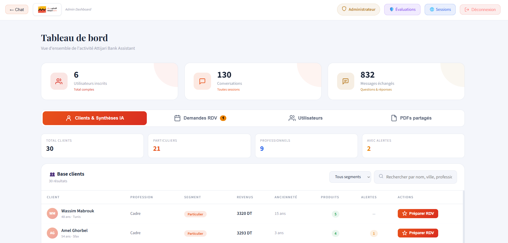
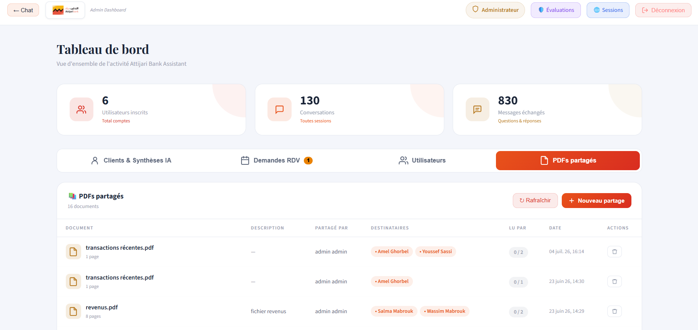
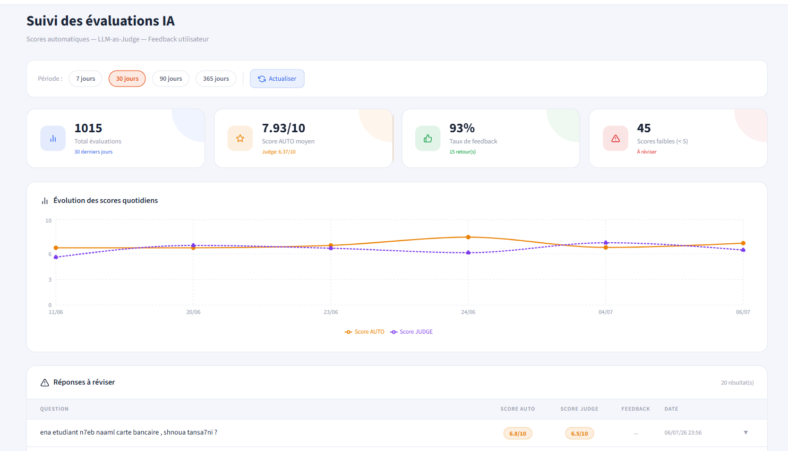
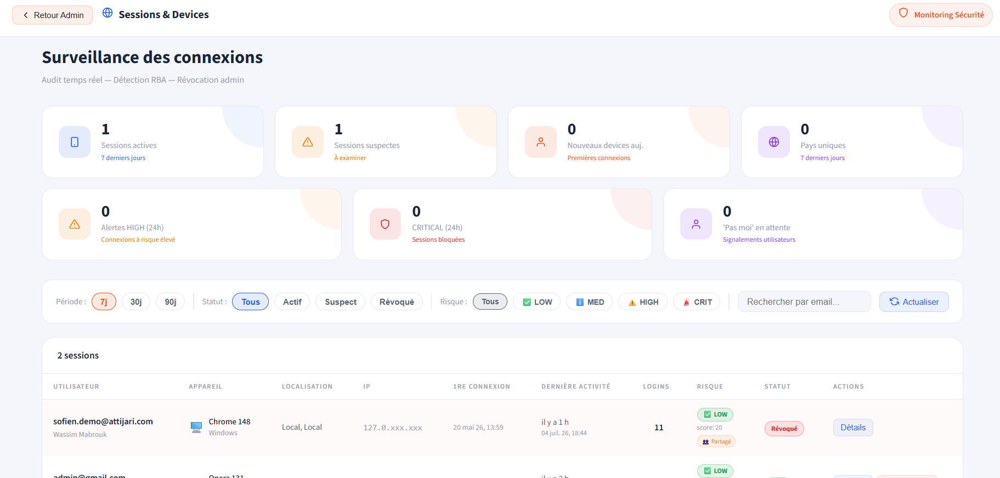
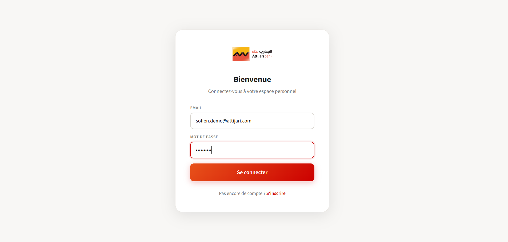

<h1 align="center">AI-Augmented Banking Customer Advisor</h1>
<h3 align="center">RAG Multi-Source System · Attijari Bank Tunisia · Engineering Final-Year Project (PFE)</h3>

<p align="center">
  
  
  
  
  
  
  
</p>

---

## 🎯 Overview

**The problem.** Bank advisors spend time answering repetitive product questions (cards, loans, savings, insurance), and many Tunisian customers write in **Derja** (Tunisian Arabic, often in Latin script), which general-purpose embedding models handle poorly.

**The solution.** A web platform built during my final-year engineering internship at **Attijari Bank Tunisia**. It combines:

- a **RAG chatbot** that answers questions **only from the bank's product documentation**, indexed in a vector store;
- **Derja-aware retrieval**: Derja questions are detected and rewritten into French search queries, and documents are embedded with a fine-tuned multilingual model;
- **advisor tools**: appointment management, AI-generated client briefs and document sharing;
- **strong authentication**: email 2FA and risk-based authentication;
- **built-in quality monitoring**: heuristic confidence score, LLM-as-a-judge and retrieval metrics.

> **Status:** academic prototype, run locally. It is not deployed and not production-ready. All client data in this repository is **synthetic**.

---

## ✨ Features

| Area | What is implemented |
| --- | --- |
| 💬 **RAG chatbot** | Hybrid retrieval (dense + keyword), *Particulier* / *Professionnel* segments, source citations, answers in French |
| 🇹🇳 **Derja support** | Rule-based Derja / Arabic-script detection, then LLM rewriting into a short French query for semantic search |
| 📄 **Multi-source context** | Product corpus, user-uploaded PDFs (isolated per session, banking-domain filter) and admin-shared PDFs with read tracking |
| 👤 **Advisor copilot** | Client-aware answers that combine a synthetic client file with the product catalog, plus AI-generated meeting briefs |
| 📅 **Appointments** | Customer requests; advisor approve / reject / propose alternative slots; availability calendar; in-app notifications |
| 🔐 **Security** | JWT, bcrypt, email 2FA, risk-based authentication, trusted devices, Fernet field encryption, “This wasn't me” incident flow, session revocation |
| 📊 **Quality & monitoring** | Per-answer auto-score, background LLM-as-a-judge, user feedback, admin dashboard with daily scores and flagged answers |
| 🧪 **Evaluation** | Gold-set retrieval metrics (Recall@k, Precision@k, MRR) and Locust load tests |

---

## 🏗️ Architecture



**How `/chat` routes a question** (`api/routes.py`):

1. **PDF mode**: if a PDF session or shared PDF is selected, retrieval runs only on that document's collection, then Groq generates the answer.
2. **Gemini path**: when `GEMINI_API_KEY` is set and `USE_GEMINI=true`, French questions are answered by Gemini Flash using dense retrieval (top 5).
3. **Groq RAG pipeline**: used when Gemini is disabled or fails, or in client mode. This path runs the full hybrid pipeline described below.
4. Every answer is scored, saved to MongoDB and streamed to the UI over Server-Sent Events.



---

## 🔎 RAG Pipeline

| Step | Implementation | Code |
| --- | --- | --- |
| **1. Collection** | Scrapers for public product pages of attijaribank.com.tn (cards, credit, savings, insurance, bundled offers, remote banking), plus a *professionnel* dataset | `scraper/`, `clean_data.py` |
| **2. Loading** | JSON corpus → LangChain `Document`s with normalized metadata (`title`, `category`, `source`, stable `doc_id`); optional PDFs via PyMuPDF (text) and pdfplumber (tables) | `load_documents.py`, `pdf_ingest.py` |
| **3. Chunking** | `RecursiveCharacterTextSplitter`, 800 characters with 100 overlap; PDF tables kept whole | `load_documents.py` |
| **4. Embeddings** | Fine-tuned Sentence-Transformers model `models/attijari-model-v2` (via `HuggingFaceEmbeddings`) | `build_vector_store.py` |
| **5. Indexing** | Persistent ChromaDB collection `attijari` in `chroma_db/` | `build_vector_store.py` |
| **6. Query handling** | Derja detection; Derja questions rewritten into a 5–10-word French query by the LLM; broad questions (“list”, “compare”…) expand *k* from 5 to 8 | `chatbot.py` |
| **7. Hybrid retrieval** | Dense similarity search (filtered by segment) + keyword scoring on title / theme / content, then merged and deduplicated | `hybrid_search()` |
| **8. Context building** | Up to 6 passages, each prefixed by its title, key factual lines prioritized (amounts, rates, fees, conditions), 1,500 characters max | `format_docs()` |
| **9. Generation** | Llama 3.3 70B through Groq's OpenAI-compatible API (temperature 0.1) with a strict “context-only” banking prompt and a fallback message when information is missing | `answer_question()` |
| **10. Evaluation** | Weighted auto-score (groundedness, citation, coverage, length) + Gemini 2.5 Flash judge (accuracy, relevance, clarity, language; hallucination flags) | `api/evaluation.py`, `api/llm_judge.py` |

> **About the embedding model.** According to [`RAPPORT_TECHNIQUE.md`](RAPPORT_TECHNIQUE.md), `attijari-model-v2` was fine-tuned from `paraphrase-multilingual-MiniLM-L12-v2` on a French / Derja parallel corpus with `MultipleNegativesRankingLoss`. The model weights and training script are **not** included in this repository.

---

## 📈 Evaluation & Measured Results

Retrieval quality is measured against an annotated gold set rather than asserted.
`rag_build_gold.py` collects the retrieved passages for each evaluation question,
`rag_preannotate.py` labels their relevance, and `rag_metrics_success_only.py`
computes the metrics and emits the LaTeX table used in the report.

**Retrieval on the annotated gold set** — 46 usable questions
(`rag_metrics_success_only_table.tex`, regenerate with `python rag_metrics_success_only.py`):

| k | Recall@k | Precision@k |
| :---: | :---: | :---: |
| 1 | 12.8 % | 32.6 % |
| 3 | 32.9 % | 32.6 % |
| 5 | 47.6 % | 31.3 % |
| 10 | **69.6 %** | 24.1 % |

**Mean Reciprocal Rank: 0.449.**

**How to read these numbers — and how not to.** Three caveats are built into the method,
and all three are in the scripts:

- **The gold labels come from an LLM pre-annotation that has not been manually verified.** The
  figures are therefore indicative, not a validated benchmark.
- **The gold set was built by pooling over the top 10 retrieved passages.** A relevant passage
  that never entered the pool was never labelled, so Recall@10 measures recall *within the pool*
  and cannot be compared to a benchmark with exhaustive judgments.
- **Exclusions are explicit**: 5 out-of-corpus questions are excluded entirely, while questions
  where no retrieved passage was relevant count as genuine failures (Recall = Precision = RR = 0)
  rather than being dropped — which is why Recall@10 is 69.6 % and not ≈ 100 %.

Precision falling as *k* rises while recall climbs is the expected trade-off: the pipeline
passes up to 6 passages to the generator, so *k* = 5 is the operating point that matters.

**Also measured**

- **Per-answer auto-score** (`api/evaluation.py`): a weighted heuristic over groundedness,
  citation, coverage and length, computed for every answer and stored in MongoDB.
- **LLM-as-a-judge** (`api/llm_judge.py`): a background Gemini 2.5 Flash pass scoring accuracy,
  relevance, clarity and language, with hallucination flags surfaced in the admin dashboard.
- **Load tests** (`locustfile.py`): Locust runs at 50 and 100 concurrent users, with the
  generated reports kept as `rapport_50_users.html` and `rapport_100_users.html`.

---

## 🧰 Tech Stack

| Layer | Technologies |
| --- | --- |
| **LLMs** | Llama 3.3 70B (`llama-3.3-70b-versatile`) on Groq · Google Gemini Flash (optional answers + judge) |
| **RAG / NLP** | LangChain (`langchain-core`, `-chroma`, `-huggingface`, `-openai`, `-text-splitters`) · Sentence-Transformers · ChromaDB |
| **Document processing** | PyMuPDF · pdfplumber · BeautifulSoup (scraping) |
| **Backend** | FastAPI · Uvicorn · Pydantic · Server-Sent Events |
| **Data** | MongoDB (`pymongo`) · Pandas · NumPy |
| **Security** | python-jose (JWT) · passlib / bcrypt · cryptography (Fernet) · user-agents |
| **Frontend** | React 19 · Vite 7 · Recharts · Lucide React |
| **Testing & evaluation** | Locust · custom RAG metrics scripts |

---

## 📁 Project Structure

```text
.
├── api/                     # FastAPI backend
│   ├── app.py               # App entry point, CORS, routers
│   ├── routes.py            # /chat, history, PDFs, admin endpoints
│   ├── auth_routes.py       # Register, login, 2FA, "not me" flow
│   ├── risk_scoring.py      # Risk-based authentication
│   ├── device_tracking.py   # Device fingerprint & IP geolocation
│   ├── crypto_utils.py      # Fernet encryption of sensitive fields
│   ├── appointment_routes.py
│   ├── clients.py           # Synthetic client files & AI briefs
│   ├── pdf_upload.py        # Per-session PDF RAG
│   ├── pdf_shared.py        # Admin-shared PDFs
│   ├── evaluation.py        # Auto-score & stats
│   └── llm_judge.py         # LLM-as-a-judge
├── attijari_chatbot/        # Main React + Vite frontend
├── client/                  # Alternative React frontend (Tailwind)
├── chatbot.py               # RAG engine
├── build_vector_store.py    # Builds the ChromaDB index
├── load_documents.py        # Corpus loading & chunking
├── pdf_ingest.py            # PDF text & table extraction
├── scraper/                 # Product page scrapers
├── data/                    # raw/ and processed/ corpus
├── scripts/                 # Seeding, migrations, maintenance
├── rag_*.py                 # Gold set & retrieval metrics
├── locustfile.py            # Load-test scenarios
├── figures/                 # Diagrams used in the report
├── docs/screenshots/        # Application captures used in this README
├── RAPPORT_TECHNIQUE.md     # Technical report (French)
└── PROJECT_SUMMARY.md       # Earlier architecture notes
```

### Where to look first

The repository keeps its full development history, including superseded code. If you are
reading it to judge the engineering, these are the files that matter:

| To understand | Read |
| --- | --- |
| **The RAG engine** | [`chatbot.py`](chatbot.py) — Derja detection, `hybrid_search()`, `format_docs()`, `answer_question()` |
| **Request routing** | [`api/routes.py`](api/routes.py) — the `/chat` decision tree diagrammed above |
| **Index construction** | [`load_documents.py`](load_documents.py) → [`build_vector_store.py`](build_vector_store.py) |
| **Security design** | [`api/risk_scoring.py`](api/risk_scoring.py), [`api/two_factor.py`](api/two_factor.py), [`api/crypto_utils.py`](api/crypto_utils.py) |
| **Quality measurement** | [`api/evaluation.py`](api/evaluation.py), [`api/llm_judge.py`](api/llm_judge.py), [`rag_metrics_success_only.py`](rag_metrics_success_only.py) |
| **Full technical write-up** | [`RAPPORT_TECHNIQUE.md`](RAPPORT_TECHNIQUE.md) (French) |

**Active vs. superseded.** `attijari_chatbot/` is the frontend in use; `client/` is an earlier
Tailwind variant kept for reference, and `backup/` and `backup_before_conflict_cleanup/` are
pre-refactor snapshots. None of the three is wired into the running stack — ignore them when
reading the code.

---

## 🚀 Installation & Running

### Prerequisites

| Tool | Notes |
| --- | --- |
| Python 3.11+ | Backend and RAG pipeline |
| Node.js 20.19+ | Required by Vite 7 |
| MongoDB | Local instance (`mongodb://localhost:27017`) or Atlas |
| Groq API key | Required, see [console.groq.com](https://console.groq.com) |
| Gemini API key | Optional (Gemini answers and LLM judge) |
| Gmail app password | For sending 2FA codes |
| Embedding model | `models/attijari-model-v2` (not versioned, see step 4) |

### 1. Clone and install the backend

```bash
git clone https://github.com/sofienkrir/Conseiller-Client-le-Augment-par-Intelligence-Artificielle_PFE.git
cd Conseiller-Client-le-Augment-par-Intelligence-Artificielle_PFE

python -m venv venv
source venv/bin/activate          # Windows: venv\Scripts\activate
pip install -r requirements.txt
pip install pymupdf pdfplumber    # imported by pdf_ingest.py, not listed in requirements.txt
pip install google-genai          # optional: Gemini answer path (api/gemini_model.py)
```

### 2. Install the frontend

```bash
cd attijari_chatbot
npm install
cd ..
```

### 3. Configure environment variables

```bash
cp .env.example .env              # Windows: copy .env.example .env

# Generate the two required secrets
python -c "from cryptography.fernet import Fernet; print(Fernet.generate_key().decode())"   # ENCRYPTION_KEY
python -c "import secrets; print(secrets.token_urlsafe(48))"                                # JWT_SECRET_KEY
```

| Variable | Required | Purpose |
| --- | --- | --- |
| `GROQ_API_KEY` | ✅ | Answer generation (Llama 3.3 70B) |
| `JWT_SECRET_KEY` | ✅ | JWT signing |
| `ENCRYPTION_KEY` | ✅ | Fernet key for sensitive client fields |
| `MONGO_URI` | ✅ | MongoDB connection string |
| `GMAIL_USER`, `GMAIL_APP_PASSWORD` | ✅ for 2FA | SMTP sender for 2FA and alert emails |
| `GEMINI_API_KEY`, `USE_GEMINI` | optional | Gemini answers and LLM judge; set `USE_GEMINI=false` to use the Groq hybrid pipeline for every question |
| `TWO_FA_*`, `TRUSTED_DEVICE_DAYS`, `RISK_*` | optional | 2FA and risk-scoring tuning (defaults in `.env.example`) |

### 4. Build the vector store

`models/attijari-model-v2` is not in the repository. Place it in `models/`, or set `EMBEDDING_MODEL_PATH` to a public Sentence-Transformers model in `chatbot.py`, `build_vector_store.py`, `api/pdf_upload.py` and `api/pdf_shared.py`.

```bash
python build_vector_store.py      # reads data/processed/*.json (+ data/pdfs/ if present) → chroma_db/
```

### 5. Seed synthetic demo data (optional)

```bash
python generate_fake_clients.py                     # 30 synthetic client files
python scripts/migrate_client_codes.py              # assigns ATB-2026-NNNN client codes
python scripts/encrypt_existing_clients.py --apply  # encrypts sensitive fields (default is --dry-run)
python scripts/seed_demo_users.py                   # demo accounts linked to two client files
python make_admin.py <email>                        # promote an account to advisor/admin
```

### 6. Run

```bash
# Terminal 1: API
uvicorn api.app:app --reload --port 8000     # Swagger UI: http://127.0.0.1:8000/docs

# Terminal 2: frontend
cd attijari_chatbot && npm run dev           # http://localhost:5173
```

The Vite dev server proxies `/chat`, `/auth`, `/api`, `/admin`, `/history`, `/upload_pdf`, `/shared_pdfs`, `/health` and `/transcribe` to the API on port 8000.

### Evaluation & load testing

```bash
python rag_build_gold.py && python rag_preannotate.py   # build and pre-annotate the gold set
python rag_metrics.py                                   # Recall@k, Precision@k, MRR (+ LaTeX table)
python get_test_token.py                                # JWT for load testing → export CHAT_JWT=...
locust -f locustfile.py --host http://127.0.0.1:8000    # UI on http://localhost:8089
```

---

## 🔐 Security & Privacy

**What the code implements**

- **Passwords** hashed with bcrypt; sessions use **HS256 JWTs**.
- **Email 2FA**: 6-digit codes from `secrets`, stored as SHA-256 hashes, with expiry (10 min by default), attempt limits and MongoDB TTL cleanup.
- **Risk-based authentication**, inspired by PSD2 transaction risk analysis. Seven configurable factors (new device, city or country, unusual hour, impossible geo-jump, shared device, automated user agent) produce a 0–100 score mapped to `ALLOW` / `WARN` / `ALERT` / `BLOCK`.
- **Trusted devices** (30 days by default), admin session revocation, and a **“This wasn't me”** incident flow.
- **Fernet encryption at rest** for sensitive client fields (phone, birth date, family status, income, balances, transaction amounts).
- **Domain filter on uploads**: only banking-related PDFs are accepted. Uploaded collections are isolated per user session and expire after 24 h.
- Secrets live in `.env`, which is git-ignored. Only `.env.example` with placeholders is versioned.

**Limitations and disclaimer**

- This is an **academic prototype**. It is **not certified**, has not been security-audited and is **not production-ready**.
- Some `/admin/*` endpoints check authentication but not the admin role server-side. This must be enforced everywhere before any real use.
- Login geolocation calls the external `ip-api.com` service over HTTP.
- Questions and retrieved context are sent to third-party LLM APIs (Groq, Google).
- All client files are **synthetic** (`generate_fake_clients.py`). The product corpus comes from public product pages.

---

## 🖼️ Screenshots & Diagrams

### Security architecture

<p align="center">
  
</p>

<sub>Source: <a href="figures/architecture_securite.svg"><code>figures/architecture_securite.svg</code></a></sub>

### The conversational advisor

<p align="center">
  
</p>

<sub><b>RAG chat.</b> The answer to <i>« Je veux construire une maison »</i> is built only from the
indexed product corpus — it names <b>Crédit Binaa</b> with its repayment term and financing ceiling,
then proposes <b>Crédit Ardhi</b> as an alternative. The sidebar shows the segment switch
(<i>Particulier</i>), the FR / تونسي language toggle, PDF attachment and voice input, and a history
mixing French and Derja questions (<i>« ena etudiant n7eb naaml carte bancaire »</i>).</sub>

### Advisor &amp; admin workspace

<table>
<tr>
<td width="50%"><br/>
<sub><b>Clients &amp; AI briefs</b> — 30 synthetic client files segmented <i>Particulier</i> /
<i>Professionnel</i>, with product counts, alerts and a <i>Préparer RDV</i> action that generates the
meeting brief.</sub></td>
<td width="50%"><br/>
<sub><b>Shared PDFs</b> — documents pushed to named recipients, each with page count and a read
counter (<code>0 / 2</code>), so an advisor can see what was actually opened.</sub></td>
</tr>
</table>

### Measured quality, in the product

<p align="center">
  
</p>

<sub><b>Evaluation dashboard.</b> The heuristic auto-score and the LLM-as-a-judge score are tracked
as two separate daily series, deliberately not collapsed into one number — the judge sits
consistently below the auto-score, which is the gap worth watching. Answers scoring under 5 are
queued for review; the flagged example here is a <b>Derja</b> question, which is where the pipeline
is weakest.</sub>

### Authentication &amp; session monitoring

<table>
<tr>
<td width="50%"><br/>
<sub><b>Risk-based authentication</b> — every session carries a device, a location, a risk band and
a score (<code>LOW · 20</code>). Sessions can be filtered by risk and revoked by an admin; the
<i>Partagé</i> tag marks a device seen on more than one account.</sub></td>
<td width="50%"><br/>
<sub><b>Sign-in</b> — the entry point to the JWT + bcrypt flow, which hands off to e-mail 2FA when
the risk score or an untrusted device requires it.</sub></td>
</tr>
</table>

<sub>All client records, accounts and documents shown are <b>synthetic</b>
(<code>generate_fake_clients.py</code>, <code>scripts/seed_demo_users.py</code>). IP addresses are
masked by the application itself.</sub>

**Not yet captured:** a Derja question answered end to end, the 2FA verification screen and its
alert e-mail, the appointment booking and approval calendar, and the Locust load-test summary.

---

## 🧭 Roadmap

These are **future improvements**, not current features:

- **True token streaming**: answers are currently generated in full, then streamed word by word over SSE.
- **Derja answers**: a Derja prompt exists in `chatbot.py`, but the main pipeline currently always answers in French.
- **Voice input**: the `/transcribe` endpoint is a stub that returns `501` until a speech-to-text model is configured.
- **Scalability**: `hybrid_search()` loads the whole collection for keyword scoring on every query; this should move to a proper BM25 or sparse index.
- **Authorization**: enforce the admin role on every `/admin/*` route.
- **Reproducibility**: publish the embedding fine-tuning script and corpus format, and complete `requirements.txt` (PyMuPDF, pdfplumber, google-genai).
- **Engineering**: Dockerize the stack, add automated tests and CI, and consolidate the two frontends and legacy backup folders.

---

## 👤 Author

**Sofien Krir**, Data Science & AI Engineer (TEK-UP University, 2026)
Final-year project carried out at the **Digital Center of Attijari Bank Tunisia**.

See also [**LangGraph AI Research Agent**](https://github.com/sofienkrir/langgraph-ai-agent) — a
research agent whose retry loop is driven by a measured coverage gate, and which declares the
sub-questions it could not answer instead of inventing an answer.

[](https://github.com/sofienkrir)
[](https://linkedin.com/in/sofien-krir-28b34b34b)
[](https://portfolio-data-science-ia-sof.vercel.app)
[](mailto:sofienkrir11@gmail.com)

<sub>Published for academic and demonstration purposes. Attijari Bank names and logos belong to their respective owners.</sub>
